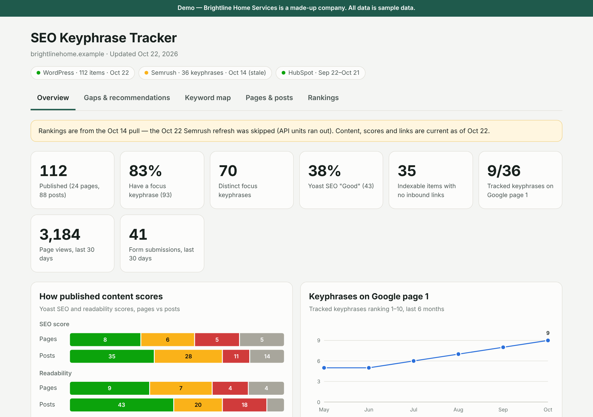

# Ashley Daniel — AI Project Coordination & Workflow Design

I turn messy, manual operations into documented, AI-assisted workflows, and I coordinate the people who build and use them.

My background is **construction project management** and **graphic design**. I now work on **AI adoption and process improvement** at a CMMC compliance consulting firm. I've also built and shipped my own AI products.

📍 Austin, TX area · 💼 [LinkedIn — ADD LINK] · ✉️ [EMAIL — ADD]

---

## What I can do for a team

| | |
|---|---|
| **Coordinate AI projects** | Act as the go-between for subject-matter experts, builders, and leadership. Keep scope, owners, and dates visible. |
| **Design AI workflows** | Map how work actually happens, then build Claude skills, connectors, and dashboards that take the repetitive parts off people's plates. |
| **Document so it sticks** | Write SOPs and setup guides for people with zero prior experience in the tool. |
| **Ship** | Take things from idea to something people can use: dashboards, apps, digital products, launch pages. |

---

## Featured work

### 1. AI adoption & operations at a CMMC compliance firm
Project tooling, SOPs, AI platform research, and coordinating an internal AI build between lead assessors, the AI team, and leadership.
→ [Case study](case-studies/ai-adoption-compliance-firm.md)

### 2. SEO Keyphrase Tracker — an AI-built dashboard
A dashboard Claude builds and refreshes from a website's CMS, rankings, and CRM data. It flags keyphrase overlap, orphan pages, and quick wins.
→ [Case study](case-studies/seo-keyphrase-tracker.md) · [**Live demo**](https://lightpromptco.github.io/ai-portfolio/demos/seo-keyphrase-tracker/) (sample data) · [The Claude skill behind it](examples/claude-skill-seo-tracker/SKILL.md)



### 3. LightPrompt — an AI wellness platform I built and run
A full-stack web app with multiple AI chat personalities, voice input, payments, and a digital product store. I also shipped a published book and several digital products alongside it.
→ [Case study](case-studies/lightprompt-platform.md)

### 4. Host Stack — productized AI operations for short-term rentals
A service and Claude skill pack for STR management companies: guest messaging, owner reports, dashboards, and team training.
→ [Case study](case-studies/host-stack.md)

---

## How I run an AI project

1. **Map the real workflow first.** Who does what, in which tool, and where the hours go.
2. **Pick one painful, repeatable task** and pilot AI there before scaling.
3. **Check governance early.** What data the AI can touch, which tools are approved, what it costs.
4. **Document it** in plain language so the team can run it without me.
5. **Make results visible** with a dashboard or report, so leadership sees what changed.

---

## Tools I work with

**AI:** Claude (Projects, Skills, connectors, Artifacts), OpenAI APIs, Claude Code
**Project & ops:** Wrike (admin, blueprints, Gantt, automations), HubSpot, Google Workspace
**Data & web:** WordPress/Yoast, Semrush, Supabase/PostgreSQL, Stripe, Vercel
**Design:** Adobe Creative Cloud, design systems, landing pages

---

## Repo map

```
case-studies/   one write-up per project: problem, what I did, result
demos/          working demos with sample data (no client data)
examples/       real artifacts, such as a Claude skill I wrote
assets/         screenshots
```

*All demos use made-up data. No client or employer data is included in this repository.*
