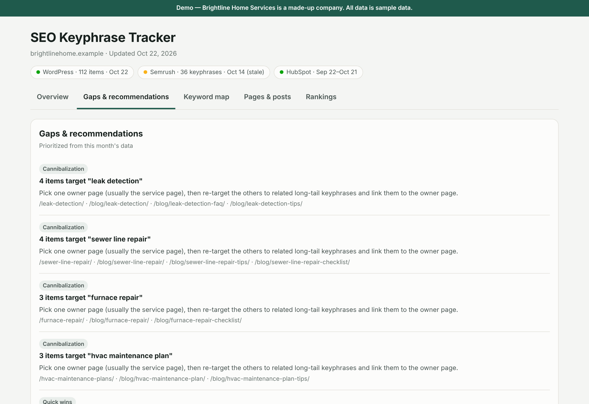

# SEO Keyphrase Tracker — an AI-built dashboard

**[Open the live demo →](https://lightpromptco.github.io/ai-portfolio/demos/seo-keyphrase-tracker/)** (sample data for a made-up company)

---

## The problem

A company website had about 200 published pages and posts, each with an SEO "focus keyphrase" set in WordPress. Nobody could see the whole picture:

- Which pages compete with each other for the same keyphrase?
- Which pages have no internal links pointing to them?
- Which keyphrases are close to page 1 of Google?
- Is the traffic turning into leads?

The answers were spread across WordPress, Yoast SEO, Semrush, and HubSpot.

## What I built

A dashboard that Claude builds and refreshes by pulling from each tool through connectors and APIs:

| Source | What it provides |
|---|---|
| WordPress + Yoast | Every page and post, word counts, internal links, focus keyphrase, SEO and readability scores |
| Semrush | Google rankings, search volume, keyword difficulty |
| HubSpot | Page views and form submissions |

**Tabs:** Overview, 6-month trends, hub & spoke topic clusters, gaps & recommendations, keyword map, keyphrases, pages & posts, rankings, and an "ask the SEO assistant" chat.

## Design decisions

- **Honest about stale data.** When the Semrush refresh failed because the account ran out of API units, the dashboard kept the last good rankings, labeled them with their date, and said so in a banner. It never mixes fresh and stale numbers silently.
- **Recommendations, not just numbers.** Each issue comes with the affected URLs and a specific fix.
- **Every metric explained.** Tooltips say what each number means and where it came from, so a non-SEO person can use it.
- **Repeatable.** I packaged the process as a [Claude skill](../examples/claude-skill-seo-tracker/SKILL.md), so anyone can rebuild or refresh the dashboard with one sentence.

## Result

The first run surfaced problems that weren't visible before: several keyphrases assigned to many pages at once, a large group of pages with no inbound links, and a set of keyphrases sitting on page 2 of Google. That gave the marketing work a prioritized to-do list instead of a guess.
